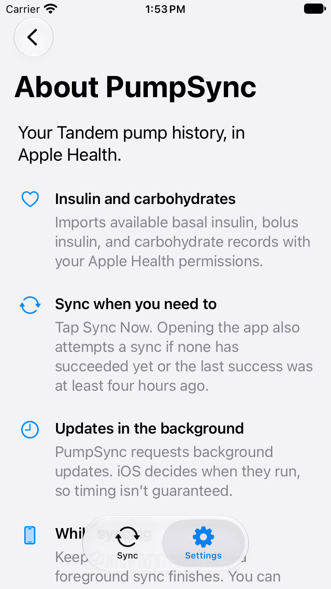
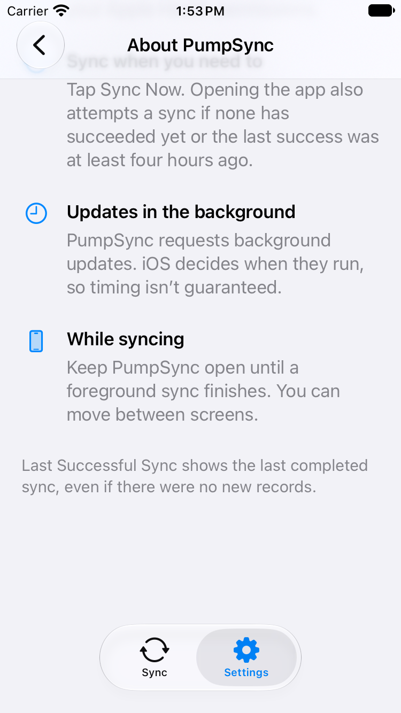
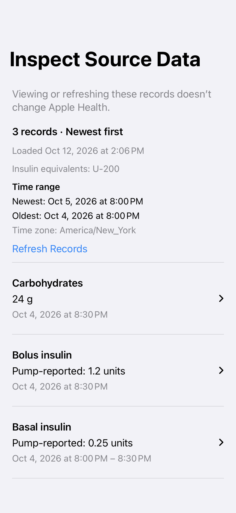
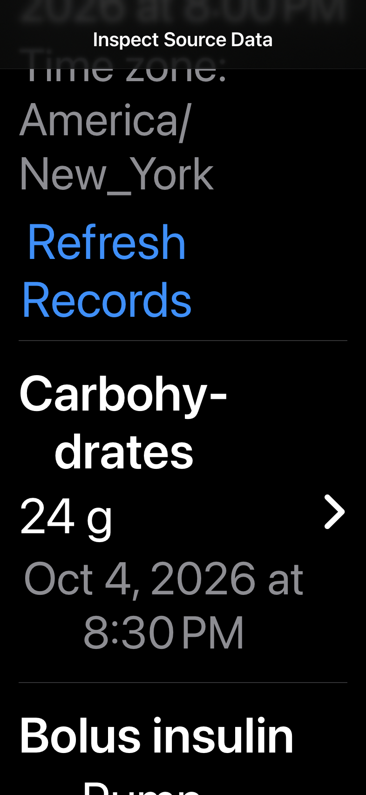
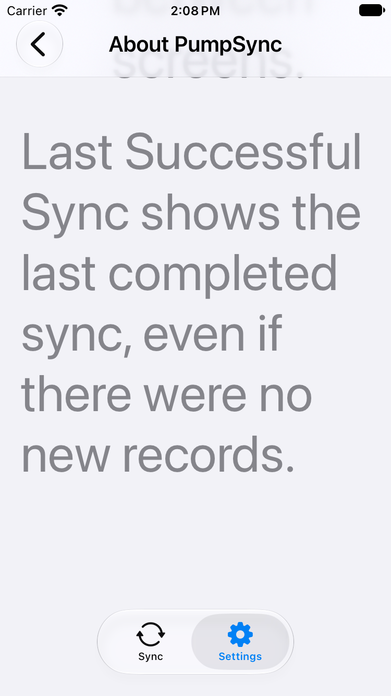

# About and source inspection review

The initial review identified a text-heavy About screen and a lifecycle defect that cleared completed inspection records when the app became inactive. That review was completed before application edits. The user subsequently approved Quick guide and the inspection fixes; the original findings below are retained as the review record.

## Initial evidence and limits

Reviewed frontend revision `9a98811` on October 12, 2026. An unrelated untracked icon-resource directory was present and was left untouched. The three supplied iPhone screenshots were inspected, along with the current SwiftUI, preview controller/session, API client, shared import planner, foreground recovery, and backend preview loader. The screenshots' installed build and OS version were not established. No live account request, simulator reproduction, new build, or accessibility runtime test was performed. Proposed layouts are concepts, not app screenshots.

1. **About — needs revision.** Supplied Image 1 shows a repeated title, long paragraphs in rounded cards, weak heading contrast, and inconsistent perceived space between paragraphs and groups.
2. **Loaded inspection — needs revision.** Image 2 shows oldest records first, an oldest-to-newest window, ambiguous Health copy, and large blue record rows. The source confirms ascending sorting and min/max display order.
3. **Resume inspection — failed in the reported flow.** Image 3 shows an unexplained empty screen and a Download Records link. The source directly explains this result. The user's leave/reopen sequence was not independently reproduced.

## Findings

### PSI-01 — High: completed preview cleared on inactivity

Classification: source-confirmed defect consistent with the supplied screenshots.

`ImportPreviewView.swift:54-55` calls `controller.cancel()` on disappearance and every non-active scene phase. `ImportPreviewController.cancel()` cancels the task and unconditionally sets `.idle`, discarding `.ready(plan)`. This happens even if the request has finished. A transient inactive phase can therefore clear records without the app being terminated. There is no explicit reload-on-activation handler in this view.

Recommendation: separate cancellation of an in-flight request from clearing the snapshot. Keep the completed plan, original query window, fetch timestamp, scroll position, and expanded record state while this inspection session survives. On activation, revalidate its account/backend ownership; do not display records for a changed account. Session recovery that renews the same account should not alone discard the snapshot. Keep the old snapshot visible while explicitly refreshing; if refresh fails, show the error alongside the old snapshot and its timestamp.

No disk persistence is needed to fix an ordinary background/resume. If the process is terminated, an in-memory snapshot cannot survive; restore a clear loading state and refetch the original window, or separately design protected on-device persistence if offline relaunch inspection is required. Avoid adding persistent health-data storage merely to fix this lifecycle bug.

Acceptance: load records, expand a row, scroll, temporarily deactivate and background the app, then resume. The same window, records, expansion, and scroll location remain. No request is made merely to restore a completed snapshot. Test interruption during loading, refresh failure, late canceled responses, account/backend replacement, same-account token recovery, navigation away/back, and process termination as separate cases.

### PSI-02 — Medium: copy blurs inspection and import

Classification: verified copy defect in the supplied images.

The intended meaning is that **viewing or refreshing this screen does not import anything into Apple Health**. It does not mean these records have never been imported by another sync. Use:

> View records from Tandem. Viewing or refreshing this screen doesn’t change Apple Health.

Replace Download Records with **Load Records**, Retry Preview with **Try Again**, and retain **Refresh Records** for an already loaded snapshot. Use **Loading records from Tandem…** for progress. An actual empty response needs **No records in this time range**, separate from loading, canceled, or failed states. Include a fetch timestamp so old snapshots are understandable.

The preview path is `POST /api/v1/preview/tandem`. The backend's `PreviewTandemUseCase` delegates to `TandemBatchLoader`, which fetches and normalizes records without keeping an import result. The frontend constructs an `ImportPlan`; the inspection path does not call the Health writer or update live sync metadata. Loading again makes a fresh API request (and may also fetch capabilities or recover authentication).

Clearing the preview discards only the temporary copy. It does not delete Tandem history, remove Health samples, or move the sync watermark. A subsequent preview can show a different window because `RealImportPreviewSession.load()` calculates its minimum from the current owned sync watermark and its maximum from the current time. Separately, the app's foreground recovery can run a normal Health-importing sync when freshness policy requires it. Do not attribute that independent sync to the inspection action. None of this establishes that a particular supplied record has successfully reached Apple Health.

Acceptance: verify preview fetch and refresh leave Health writes, last-success time, and sync watermark unchanged; verify explicit empty and failed states are distinguishable.

### PSI-03 — Medium: list and query window order

Classification: verified presentation mismatch with the requested order.

`ImportPlanner.makePlan` sorts samples by ascending `startAt`, with deterministic ID ordering for ties. `ImportPreviewView` renders that array directly and prints `effectiveMinDate` before `effectiveMaxDate`.

Recommendation: sort the **inspection presentation** by descending start time, with a stable tie-breaker, without changing shared import planning just to reorder a screen. Label the summary **Newest** and **Oldest**, with newest first. Keep every individual basal interval's start → end chronological; reversing that interval would imply the wrong duration. Effective min/max describe the query window, not necessarily the earliest/latest returned record; label them accordingly.

Acceptance: shuffled samples render newest first with stable equal-time ordering, including mixed record types, overnight basal intervals, and an empty window.

### PSI-04 — Polish: About hierarchy and density

Classification: subjective design recommendation grounded in Image 1 and shared UI components.

Keep the existing large navigation title, system grouped background, 20-point outer inset, SF Symbols, semantic text sizes, and app navigation. Remove the repeated About heading and the paragraph cards. Keep consistent section spacing and shorten the content.

Three alternatives:

- **Quick guide — recommended:** one-line purpose followed by four icon-led rows: what gets synced, manual/open-app sync, background timing, and keeping the app open. Matches the icon column and title/detail rhythm already used by `GlassNavigationRow` and `GlassStatusRow`; all key guidance remains visible.
- **Editorial:** purpose paragraph and three short sections divided by hairlines. Calmest presentation, but still requires more reading.
- **Questions:** purpose line and four disclosure rows. Compact initial screen with optional detail, but important guidance takes additional taps. Keep basic purpose visible and avoid burying essential syncing guidance.

Suggested primary copy: “Your Tandem pump history, in Apple Health.” Explain connection-versus-success at the connection status or in optional details. Retain the qualified four-hour goal: it is not a delivery guarantee.

Acceptance: review standard and maximum accessibility text, light/dark mode, increased contrast, safe-area clearance, and VoiceOver headings/order on a running app. Do not reduce font size to make the copy fit.

### PSI-05 — Medium: “source” values are converted

Classification: source-supported semantic risk.

The row displays `sample.convertedValue`, calculated by the selected insulin concentration, rather than the original pump-reported value. Calling this screen source inspection without identifying that transformation can mislead a person comparing the values with Tandem. Show **Pump-reported amount** and **Apple Health amount at U-200** (using the selected concentration) in expanded details, with a concise label on the main amount. Retain the original record type, timestamp, and source identity. Test that changing concentration cannot silently leave an incorrectly labeled cached value.

## Initial coverage and next work

Checked: supplied screenshots, visual density/hierarchy, local preview API/Health boundary, ascending order, lifecycle reset, shared UI patterns, independent foreground-sync policy.

Not checked: live-provider availability, actual Health contents, installed build correspondence, device lifecycle reproduction, Dynamic Type, contrast measurement, VoiceOver, and process-termination recovery.

Prioritize PSI-01, then PSI-02/03/05. Select an About concept before implementing PSI-04. Add focused lifecycle/ordering/boundary tests and verify the requested leave/resume flow on a real device. This review is not release or distribution validation.

## Approved implementation

Quick guide replaces paragraph cards with SF Symbol rows, semantic headings, and shorter text. The existing system NavigationStack Back control is retained; the original mockup's blue parent-title link was not an accurate representation of current iOS chrome. Apple's [Toolbars guidance](https://developer.apple.com/design/human-interface-guidelines/toolbars) recommends the standard Back and Close controls.

The About timing copy now describes the actual four-hour **app-open freshness threshold**, rather than a promise to keep Health less than four hours behind. The canonical [sync behavior documentation](https://github.com/eslutz/PumpSync/wiki/Architecture#sync-behavior) was aligned with the current coordinator and scheduler. The user must still keep a foreground sync open; last-success time can advance on a successful sync with zero new records.

Inspection retains completed snapshots during normal inactivity/background/resume and tab changes, and keeps the existing snapshot while refreshing. Transient refresh failures leave the prior data and fetch time visible. No health records are written to disk for this feature; process termination ends this in-memory snapshot. Account/backend changes or connection removal invalidate it. In-flight responses still require strict current context and operation identity before publishing. A display-only context comparison permits viewing the same snapshot through same-account connection renewal; it is never used by Health import authorization.

The list is newest first without changing the import planner. Time-range bounds are shown newest first, while basal intervals remain chronological. Pump-reported insulin units are now the primary row value; expanded details separately identify the Apple Health equivalent, concentration, and multiplication factor. These values do not claim a completed import. Carb amounts remain grams.

### Runtime screenshots

These are iPhone SE (3rd generation), iOS 27.0 simulator screenshots of the About screen reached through Settings. They use the app's existing screenshot fixture and are not physical-device acceptance.

The inspection screenshots below use synthetic records in a test-target renderer, not an authenticated provider session.

### Validation completed

- The new lifecycle regression test first reproduced the original failure when the scene became inactive. The baseline runner was stopped after it emitted that expected failure; its raw log is retained.
- Full simulator suite: 387 unit tests and 19 UI tests passed, zero failures. The validation script's build-warning gate passed.
- Final focused run after copy, styling, and test refinements: 25 unit tests and 2 UI tests passed, zero failures; warning gate passed.
- About navigation and footer test passed with the actual simulator content-size setting at accessibility-extra-extra-extra-large. The prior setting was restored afterward.
- Checks cover cached load without a new request, background/resume retention, strict account invalidation, same-account connection renewal, canceled refresh responses, transient refresh failure, captured concentration, and deterministic newest-first ordering without changing import order.
- Independent static review found no actionable issues. Frontend and wiki whitespace checks passed; updated wiki heading links were checked.

Environment: Xcode 27.0 (27A266a), iOS 27.0 simulator, iPhone SE (3rd generation). Logs and result bundles are retained under ignored `TestResults/AboutSourceInspection-20261012/`.

Visual limitation: the system large navigation title truncates at maximum accessibility size on the SE; the compact title is fully visible after scrolling. The body and final footer remain reachable. This is simulator evidence, not a physical-device installation or live Apple Health/provider acceptance. VoiceOver and measured contrast acceptance remain untested.
