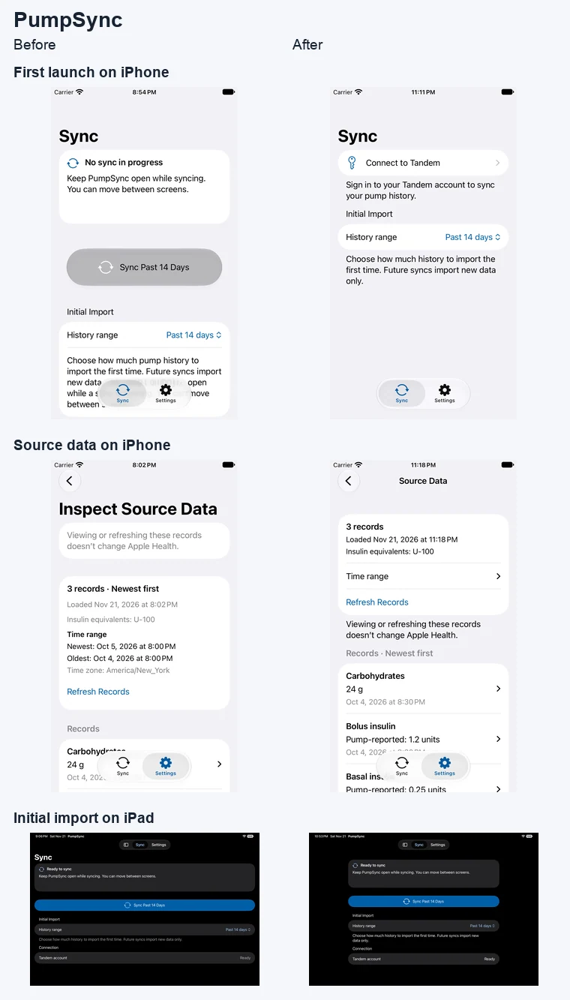

# Direct-client screen review

The compact Sync screen now opens with the next available action. A new user can connect to Tandem without scrolling. A returning user who needs to reconnect, or a connected user who needs Apple Health access, sees the relevant setup link in the same place. A ready account sees sync status and the import action.

The phone pairs show complete screens. The tablet pair shows the upper half of the same initial-import view at the same scale. At standard text size, the iPad import button measured 992 points across before the wide-layout change and 680 points after it. The reading width scales with Dynamic Type. The Sync action’s white symbol measured 6.66:1 against the blue button on the light iPhone SE and 6.56:1 on the dark iPhone 17. The compact setup instructions and source inspection notice each measured 18.82:1 against the light grouped background.

| Screens reviewed | Result |
| --- | --- |
| Sync | Setup leads when required. Progress, success, and recovery keep their positions. The actionable notice uses regular Liquid Glass and supports an opaque surface with Reduce Transparency. On compact Settings screens it clears the Apple Health row and the tab bar. At accessibility text sizes the form and notice have separate space to scroll, so people can reach every Settings destination while the notice is open. On a wide iPad window it sits near the bottom, clear of the inline status. |
| Settings and Tandem | Settings groups account and import controls together. The saved-account summary, credential editor, region menu, and one-time reconnect retain native navigation and controls. |
| Apple Health, Insulin Concentration, Insulin Conversion | Permission statuses use text. The concentration picker exposes its selection, and conversion factors and guidance remain available at their own destination. |
| Data Handling and About PumpSync | Data Handling groups credentials, pump data, and legacy requests. The guide explains both manual imports and the timing of automatic updates. |
| Developer and Source Data | Diagnostic tools precede build information. Source records are visible earlier. Date bounds and time zone expand on demand. The read-only notice and refresh controls remain accessible. |
| App Event Log, App Event, Performance, Report | Native menus, clear confirmations, exports, grouped events, timelines, and report disclosures remain available. Wide windows use a centered reading column and retain the system navigation controls. |

## Verification

The baseline was the direct-client revision `30cce2b`, version 1.0.0 (37). The revised UI was built with Xcode 27.2.

203 tests passed on iPhone SE (3rd generation), iOS 27.0. The recovery and typography checks passed again at the standard text size (4) and the largest accessibility size (4). On iOS 27.2, 9 iPad Pro 13-inch (M5) checks passed in Dark Mode with Increase Contrast, and 4 iPhone 17 checks passed in Dark Mode. These runs recorded zero failures, skips, or runtime warnings. The recovery notice was also inspected with the iPhone 17 simulator’s system Reduce Transparency setting enabled.

The review used synthetic accounts and records. Live Tandem access and physical-device HealthKit acceptance are separate from the visual checks. The compact run includes the existing VoiceOver journeys and accessibility audits. Native credential, Health authorization, and sharing sheets are supplied by the system.

The native action and navigation layers use Liquid Glass. Grouped forms and lists keep their standard content backgrounds. [Apple Human Interface Guidelines on materials](https://developer.apple.com/design/human-interface-guidelines/materials) · [Adopting Liquid Glass](https://developer.apple.com/documentation/technologyoverviews/adopting-liquid-glass)
